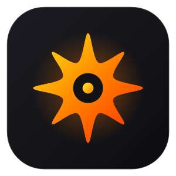
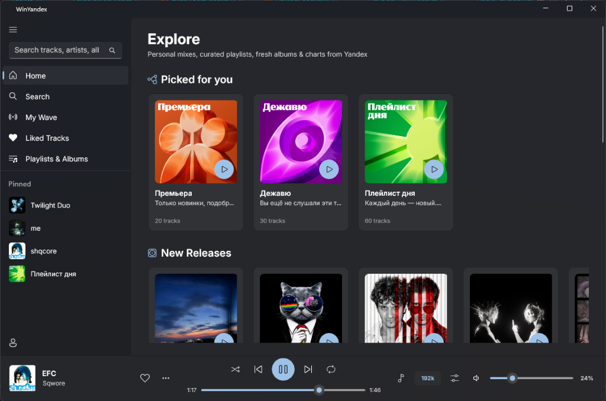
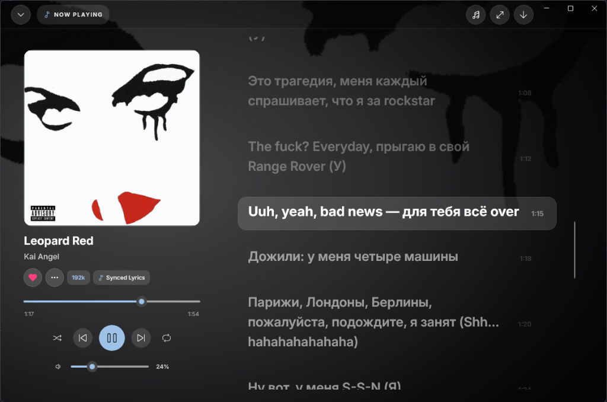

<p align="center">
  
</p>

<h1 align="center">WinYandex</h1>

<p align="center">
  <strong>Modern native desktop client for Yandex Music on Windows 10/11</strong>
</p>

<p align="center">
  <strong>English</strong> • <a href="README_ru.md">Русский</a>
</p>

<p align="center">
  <a href="https://github.com/pixiemays/WinYandex"></a>
  <a href="https://dotnet.microsoft.com/"></a>
  <a href="https://github.com/microsoft/WindowsAppSDK"></a>
  <a href="LICENSE"></a>
</p>

---

**WinYandex** is a fast and lightweight desktop player for Yandex Music, built from scratch on the native Windows stack (WinUI 3 + Windows App SDK + C# .NET 8) as an alternative to the Electron web wrapper.

<p align="center">
  
</p>

<p align="center">
  
</p>

---

## Features

* **Fluent Design** — Windows 11 style visual interface featuring Mica material, fluid transitions, and seamless dark and light theme switching.
* **Sharp Typography** — Inter Variable display font by default, with settings to select official Yandex Sans or system Segoe UI Variable.
* **Disk Audio Cache (LRU)** — Caches played tracks locally (`%LocalAppData%/YMusic/Cache`) for instant subsequent playback (0 ms) without wasting network bandwidth.
* **Gapless Playback** — Preloads the audio stream and lyrics for the upcoming track at 80% progress of the current song to eliminate pauses and buffering.
* **Synchronized Lyrics** — Slide-up Now Playing panel with real-time, line-by-line synchronized lyrics scrolling.
* **10-Band Equalizer** — Audio frequency adjustment from 31 Hz to 16 kHz with built-in presets (Rock, Pop, Bass Boost, Acoustic, Vocal, and more).
* **Vibe (My Wave)** — Personalized infinite music stream with mood filters (*Calm, Energetic, Joyful, Melancholic*) and activity filters (*Work, Relax, Commute, Workout*).
* **FckCensor** — Automatically picks original uncensored tracks instead of copyright-holder silenced versions.
* **Discord Rich Presence** — Displays track name, artist, album art, and playback status directly on your Discord profile.
* **Windows Integration**:
  * System Media Transport Controls (SMTC) — System overlay and full support for hardware multimedia keys and headsets.
  * Taskbar Thumbnail Toolbar — Control playback right from the Windows taskbar thumbnail preview.
  * System Tray — Windows tray icon with context menu and minimize-to-tray support on window close.
  * Toast Notifications — Native popup banners when switching tracks.
* **Bilingual Interface** — Instant runtime switching between Russian and English without restarting the application.

---

## Installation & Getting Started

### 1. Setup.exe Installer (Recommended)
Download the latest `Setup-x64.exe` installer from the [Releases](https://github.com/pixiemays/WinYandex/releases/latest) section. The installer sets up Start menu and Desktop shortcuts.

### 2. Portable Version (ZIP)
Download the portable `win-x64-portable.zip` archive from [Releases](https://github.com/pixiemays/WinYandex/releases/latest), extract to any folder, and run `WinYandex.exe`. The application is fully standalone and requires no extra dependencies.

### 3. MSIX Bundle Package
To install as a native Windows package, run the `WinYandex_x64.msixbundle` file.

---

## Building from Source

### Prerequisites
* Windows 10 (1809+) or Windows 11
* [.NET 8 SDK](https://dotnet.microsoft.com/download/dotnet/8.0)
* Visual Studio 2022 (with Windows app development workload) or VS Code with C# Dev Kit

### Build and Run:
```powershell
# Clone the repository
git clone https://github.com/pixiemays/WinYandex.git
cd WinYandex

# Run in development mode
dotnet run --project src/YMusic.WinUI/YMusic.WinUI.csproj
```

### Packaging Releases and Distributions:
```powershell
powershell -ExecutionPolicy Bypass -File scripts/package_release.ps1
```
*Distribution artifacts are output to the `dist/` directory.*

---

## Architecture & Tech Stack

* **UI:** Windows App SDK (WinUI 3) + .NET 8
* **Architecture:** MVVM (CommunityToolkit.Mvvm)
* **Audio:** Windows MediaFoundation / NAudio
* **Fonts:** Inter Variable & Yandex Sans Text
* **Integrations:** DiscordRichPresence, Windows.Media.SystemMediaTransportControls, Microsoft.Windows.AppNotifications

---

## Disclaimer

* WinYandex is an unofficial open-source client.
* "Yandex", "Yandex Music", and associated trademarks belong to Yandex LLC.
* This project is not affiliated with or endorsed by Yandex.
* An active Yandex Plus subscription is required to access your personal library and stream high-quality audio.

---

## License

Distributed under the free copyleft [GNU General Public License v3.0](LICENSE). All modifications and derivative works must remain open-source under the same license. This protects the project from being closed-sourced or commercially repackaged.
